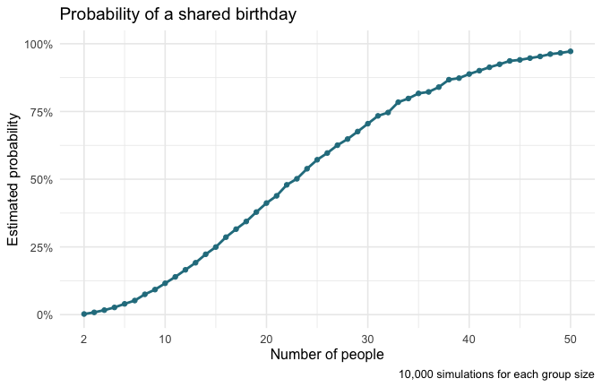
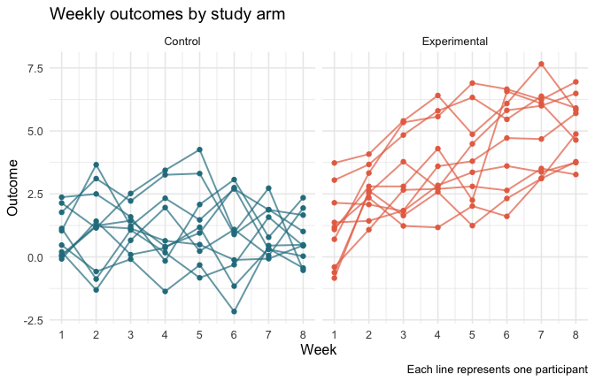
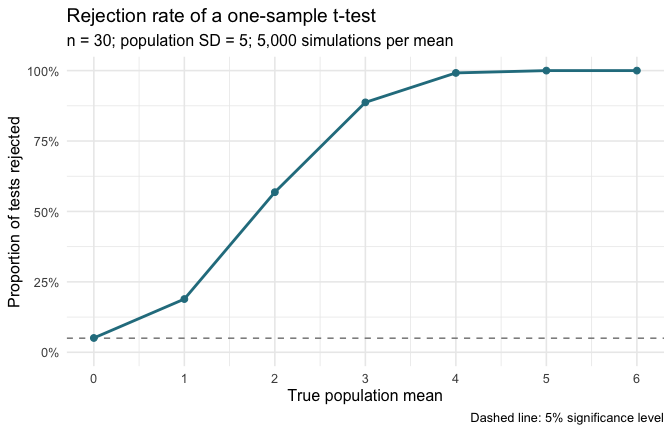
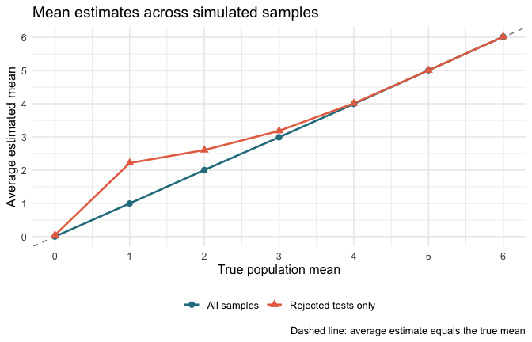

P8105 Homework 5
================
Xueying Jia

# Problem 1: Shared birthdays

I assume birthdays are independent and equally likely on each of the 365
days of a non-leap year.

``` r
sim_birthday = function(n) {
  birthdays = sample(1:365, size = n, replace = TRUE)
  any(duplicated(birthdays))
}

set.seed(1)

sim_birthday(n = 23)
```

    ## [1] TRUE

## Repeat the simulation

``` r
set.seed(1)

birthday_results =
  expand_grid(
    group_size = 2:50,
    iteration = 1:10000
  ) |>
  mutate(
    shared_birthday = map_lgl(group_size, sim_birthday)
  )

birthday_summary =
  birthday_results |>
  group_by(group_size) |>
  summarise(
    probability = mean(shared_birthday),
    .groups = "drop"
  )

birthday_summary |>
  filter(group_size %in% c(2, 10, 23, 30, 50)) |>
  knitr::kable(
    digits = 3,
    caption = "Estimated probability of at least one shared birthday"
  )
```

| group_size | probability |
|-----------:|------------:|
|          2 |       0.002 |
|         10 |       0.116 |
|         23 |       0.502 |
|         30 |       0.705 |
|         50 |       0.972 |

Estimated probability of at least one shared birthday

## Visualize the results

``` r
birthday_summary |>
  ggplot(aes(x = group_size, y = probability)) +
  geom_line(color = "#287D8E", linewidth = 1) +
  geom_point(color = "#287D8E", size = 1.5) +
  scale_x_continuous(
    breaks = c(2, 10, 20, 30, 40, 50)
  ) +
  scale_y_continuous(
    labels = scales::label_percent(accuracy = 1),
    limits = c(0, 1)
  ) +
  labs(
    title = "Probability of a shared birthday",
    x = "Number of people",
    y = "Estimated probability",
    caption = "10,000 simulations for each group size"
  )
```

<!-- -->

For each group size, I estimated the probability of at least one shared
birthday as the proportion of 10,000 simulations that returned TRUE. The
estimated probability increases with group size: it is approximately 50%
for 23 people and 97% for 50 people. Larger groups contain more possible
pairs of people, creating more opportunities for a shared birthday.

# Problem 2: Longitudinal study

## Import participant files

``` r
study_files =
  tibble(
    file_path = list.files(
      path = "data",
      pattern = "\\.csv$",
      recursive = TRUE,
      full.names = TRUE
    )
  ) |>
  mutate(
    file_name = basename(file_path)
  )

study_nested =
  study_files |>
  mutate(
    data = map(file_path, read_csv, show_col_types = FALSE)
  )

nrow(study_nested)
```

    ## [1] 20

``` r
study_nested |>
  select(file_name, data)
```

    ## # A tibble: 20 × 2
    ##    file_name  data              
    ##    <chr>      <list>            
    ##  1 con_01.csv <spc_tbl_ [1 × 8]>
    ##  2 con_02.csv <spc_tbl_ [1 × 8]>
    ##  3 con_03.csv <spc_tbl_ [1 × 8]>
    ##  4 con_04.csv <spc_tbl_ [1 × 8]>
    ##  5 con_05.csv <spc_tbl_ [1 × 8]>
    ##  6 con_06.csv <spc_tbl_ [1 × 8]>
    ##  7 con_07.csv <spc_tbl_ [1 × 8]>
    ##  8 con_08.csv <spc_tbl_ [1 × 8]>
    ##  9 con_09.csv <spc_tbl_ [1 × 8]>
    ## 10 con_10.csv <spc_tbl_ [1 × 8]>
    ## 11 exp_01.csv <spc_tbl_ [1 × 8]>
    ## 12 exp_02.csv <spc_tbl_ [1 × 8]>
    ## 13 exp_03.csv <spc_tbl_ [1 × 8]>
    ## 14 exp_04.csv <spc_tbl_ [1 × 8]>
    ## 15 exp_05.csv <spc_tbl_ [1 × 8]>
    ## 16 exp_06.csv <spc_tbl_ [1 × 8]>
    ## 17 exp_07.csv <spc_tbl_ [1 × 8]>
    ## 18 exp_08.csv <spc_tbl_ [1 × 8]>
    ## 19 exp_09.csv <spc_tbl_ [1 × 8]>
    ## 20 exp_10.csv <spc_tbl_ [1 × 8]>

``` r
study_nested$data[[1]]
```

    ## # A tibble: 1 × 8
    ##   week_1 week_2 week_3 week_4 week_5 week_6 week_7 week_8
    ##    <dbl>  <dbl>  <dbl>  <dbl>  <dbl>  <dbl>  <dbl>  <dbl>
    ## 1    0.2  -1.31   0.66   1.96   0.23   1.09   0.05   1.94

## Tidy the data

``` r
study_df =
  study_nested |>
  select(file_name, data) |>
  mutate(
    subject_id = str_remove(file_name, "\\.csv$"),
    arm = recode(
      str_sub(subject_id, 1, 3),
      con = "Control",
      exp = "Experimental"
    )
  ) |>
  unnest(cols = data) |>
  pivot_longer(
    cols = starts_with("week_"),
    names_to = "week",
    names_prefix = "week_",
    values_to = "outcome"
  ) |>
  mutate(
    week = as.integer(week)
  ) |>
  select(subject_id, arm, week, outcome) |>
  arrange(arm, subject_id, week)

dim(study_df)
```

    ## [1] 160   4

``` r
study_df |>
  head(8) |>
  knitr::kable(
    caption = "Weekly observations for the first participant"
  )
```

| subject_id | arm     | week | outcome |
|:-----------|:--------|-----:|--------:|
| con_01     | Control |    1 |    0.20 |
| con_01     | Control |    2 |   -1.31 |
| con_01     | Control |    3 |    0.66 |
| con_01     | Control |    4 |    1.96 |
| con_01     | Control |    5 |    0.23 |
| con_01     | Control |    6 |    1.09 |
| con_01     | Control |    7 |    0.05 |
| con_01     | Control |    8 |    1.94 |

Weekly observations for the first participant

I combined the participant files using map() and unnest(), extracted
participant IDs and study arms from the filenames, and reshaped the
weekly measurements into long format. Participant IDs retain the arm
prefix to distinguish participants with the same number in different
arms.

The tidy dataset contains 160 observations from 20 participants: 10 in
the control arm and 10 in the experimental arm. Each participant has
measurements at eight weeks. Each row represents one participant at one
week, with columns for participant ID, study arm, week, and outcome.

## Plot individual trajectories

``` r
study_df |>
  ggplot(
    aes(
      x = week,
      y = outcome,
      group = subject_id,
      color = arm
    )
  ) +
  geom_line(alpha = 0.7, linewidth = 0.7) +
  geom_point(size = 1.5) +
  facet_grid(. ~ arm) +
  scale_x_continuous(breaks = 1:8) +
  scale_color_manual(
    values = c(
      "Control" = "#287D8E",
      "Experimental" = "#E76F51"
    )
  ) +
  labs(
    title = "Weekly outcomes by study arm",
    x = "Week",
    y = "Outcome",
    caption = "Each line represents one participant"
  ) +
  theme(legend.position = "none")
```

<!-- -->

The control arm shows fluctuations over time without a clear overall
upward or downward trend. In contrast, participants in the experimental
arm generally show increasing outcomes over the eight weeks. Both arms
show differences between participants and week-to-week variation within
participants.

# Problem 3: Power of a one-sample t-test

## Simulation design

I simulated samples of 30 observations from normal distributions with a
population standard deviation of 5. The true means ranged from 0 to 6.
For each sample, I performed a two-sided one-sample t-test of a
population mean of zero, using a significance level of 0.05.

``` r
sim_t_test = function(mu, n = 30, sigma = 5) {
  sample_data = rnorm(
    n = n,
    mean = mu,
    sd = sigma
  )

  t.test(
    sample_data,
    mu = 0,
    alternative = "two.sided"
  ) |>
    broom::tidy() |>
    select(
      mu_hat = estimate,
      p_value = p.value
    )
}

set.seed(1)

sim_t_test(mu = 0)
```

    ## # A tibble: 1 × 2
    ##   mu_hat p_value
    ##    <dbl>   <dbl>
    ## 1  0.412   0.629

## Repeat the simulation

``` r
set.seed(1)

test_results =
  expand_grid(
    true_mu = 0:6,
    iteration = 1:5000
  ) |>
  mutate(
    result = map(true_mu, sim_t_test)
  ) |>
  unnest(cols = result) |>
  mutate(
    reject = p_value < 0.05
  )

dim(test_results)
```

    ## [1] 35000     5

``` r
power_summary =
  test_results |>
  group_by(true_mu) |>
  summarise(
    n_sim = n(),
    n_reject = sum(reject),
    rejection_rate = mean(reject),
    mean_estimate = mean(mu_hat),
    mean_estimate_rejected = mean(mu_hat[reject]),
    .groups = "drop"
  )

knitr::kable(
  power_summary,
  digits = 3,
  caption = "Simulation results by true population mean"
)
```

| true_mu | n_sim | n_reject | rejection_rate | mean_estimate | mean_estimate_rejected |
|--------:|------:|---------:|---------------:|--------------:|-----------------------:|
|       0 |  5000 |      254 |          0.051 |         0.000 |                  0.043 |
|       1 |  5000 |      945 |          0.189 |         0.996 |                  2.214 |
|       2 |  5000 |     2842 |          0.568 |         2.004 |                  2.604 |
|       3 |  5000 |     4436 |          0.887 |         2.990 |                  3.183 |
|       4 |  5000 |     4959 |          0.992 |         3.993 |                  4.011 |
|       5 |  5000 |     5000 |          1.000 |         5.007 |                  5.007 |
|       6 |  5000 |     5000 |          1.000 |         6.018 |                  6.018 |

Simulation results by true population mean

## Rejection rate and power

``` r
power_summary |>
  ggplot(aes(x = true_mu, y = rejection_rate)) +
  geom_hline(
    yintercept = 0.05,
    linetype = "dashed",
    color = "grey55"
  ) +
  geom_line(color = "#287D8E", linewidth = 1) +
  geom_point(color = "#287D8E", size = 2) +
  scale_x_continuous(breaks = 0:6) +
  scale_y_continuous(
    labels = scales::label_percent(accuracy = 1),
    limits = c(0, 1)
  ) +
  labs(
    title = "Rejection rate of a one-sample t-test",
    subtitle = "n = 30; population SD = 5; 5,000 simulations per mean",
    x = "True population mean",
    y = "Proportion of tests rejected",
    caption = "Dashed line: 5% significance level"
  )
```

<!-- -->

With sample size and population standard deviation fixed, power
increases as the true mean moves farther from the null value of zero.
The estimated power is 18.9% at a true mean of 1 and 88.7% at a true
mean of 3. At true means of 5 and 6, all 5,000 simulations reject the
null hypothesis, giving empirical rejection rates of 100%.

When the true mean is zero, the null hypothesis is true. The rejection
rate of approximately 5.1% therefore estimates the Type I error rate,
which is close to the chosen significance level of 5%.

## Compare mean estimates

``` r
estimate_plot_df =
  power_summary |>
  select(true_mu, mean_estimate, mean_estimate_rejected) |>
  pivot_longer(
    cols = starts_with("mean_estimate"),
    names_to = "samples_used",
    values_to = "average_estimate"
  ) |>
  mutate(
    samples_used = recode(
      samples_used,
      mean_estimate = "All samples",
      mean_estimate_rejected = "Rejected tests only"
    )
  )

estimate_plot_df |>
  ggplot(
    aes(
      x = true_mu,
      y = average_estimate,
      color = samples_used,
      shape = samples_used
    )
  ) +
  geom_abline(
    intercept = 0,
    slope = 1,
    linetype = "dashed",
    color = "grey55"
  ) +
  geom_line(linewidth = 0.9) +
  geom_point(size = 2.5) +
  scale_color_manual(
    values = c(
      "All samples" = "#287D8E",
      "Rejected tests only" = "#E76F51"
    )
  ) +
  scale_shape_manual(
    values = c(
      "All samples" = 16,
      "Rejected tests only" = 17
    )
  ) +
  scale_x_continuous(breaks = 0:6) +
  scale_y_continuous(breaks = 0:6) +
  labs(
    title = "Mean estimates across simulated samples",
    x = "True population mean",
    y = "Average estimated mean",
    color = NULL,
    shape = NULL,
    caption = "Dashed line: average estimate equals the true mean"
  ) +
  theme(legend.position = "bottom")
```

<!-- -->

Across all simulated samples, the average estimated mean is close to the
true mean, consistent with the sample mean being an unbiased estimator.

Restricting the analysis to rejected tests produces upward bias for
small positive true means. For example, when the true mean is 1, the
average estimate is approximately 0.996 across all samples but 2.214
among rejected tests. Statistical significance depends on the estimated
mean relative to its standard error. With a small positive true effect,
rejected tests disproportionately include samples with upward
fluctuations in their estimated means.

As the true effect increases and power approaches one, most samples are
retained, so the two averages become similar. At a true mean of zero,
positive and negative significant estimates approximately balance in
this two-sided test, leaving their average close to zero.
